# corne-zmk-config

ZMK firmware config for a wireless Corne (crkbd) with nice!nano v2 controllers —
"stealth AZERTY": AZERTY letters typed unchanged through a **UK `gb` host layout**,
plus custom punctuation and French/Spanish accents.



## Keymap concept

The host OS stays on a UK layout. Letters are physically arranged in AZERTY order
(`A Z E R T` top row, `Q S D F G` home, `W X C V B` bottom) and send their own HID
codes — since A–Z are layout-independent, a UK host types them unchanged. Only
punctuation and accents need host-aware tricks: mod-morphs for shifted variants and
AltGr/dead-key macros for accented characters.

### Layers

| # | Name | Activator | Contents |
|---|------|-----------|----------|
| 0 | **Typing** | base | AZERTY letters, custom punctuation, Bspc/Del (only here) |
| 1 | **Nav** | hold left middle thumb | F1–F10, media keys, arrows, Home/End/PgUp/PgDn, word-jump (Ctrl+←/→), app launchers (⌘⌃⇧+T/S/B/; → Ghostty/Spotify/Brave/Slack) |
| 2 | **Num+Sym** | hold right middle thumb | numpad-style digits, brackets, operators |
| 3 | **Accent/Sym** | hold **both** thumbs (conditional layer) | French accents (à â é è ê ë ù û ü î ï ô ç), ñ, €, $, #, Bluetooth slot select |

### Design rules

- **Bspc/Del live only on the Typing layer** — no accidental deletes while navigating.
- **Punctuation mod-morphs** — shift changes the character: `,→?` `.→!` `'→"` `@→&` `/→|` `é→€`.
- **Accents cluster around their base letter**; symbols sit on a mnemonic key.
- Accents are macros over a UK host: dead-key grave, `AltGr` combos (`AltGr+6`+letter
  for circumflex, `AltGr+2`+letter for diaeresis, `AltGr+E` for é, `AltGr+C` for ç,
  `AltGr+\`+N for ñ).
- Bluetooth slots 0/1/2 on the rightmost column of the Accent/Sym layer.

## Repo layout

```
config/corne.keymap   # the whole keymap (single file, commented)
build.yaml            # GitHub Actions build matrix (corne_left, corne_right, settings_reset)
tools/                # keymap-drawer rendering, watch mode, key tester — see tools/README.md
boards/shields/       # empty; stock zmk corne shield is used
zephyr/module.yml     # makes this repo a Zephyr module
```

## Building

Firmware builds in GitHub Actions on every push via the standard
[zmk user-config workflow](.github/workflows/build.yml). Download the `firmware`
artifact from the latest run; it contains `corne_left`, `corne_right`, and
`settings_reset` UF2 images.

### Flashing

1. Double-tap the reset button on a half to enter the bootloader (USB mass storage).
2. Copy the matching `.uf2` onto the drive; it reboots when done.
3. Flash `corne_left` to the left half, `corne_right` to the right.
4. If the halves won't pair, flash `settings_reset` to both, then re-flash firmware.

## Editing the keymap

1. Edit `config/corne.keymap`.
2. Preview locally: `./tools/render.sh` (or `./tools/watch.sh` for live reload) —
   see [tools/README.md](tools/README.md).
3. Push — CI builds the firmware.

## Links

- [ZMK docs](https://zmk.dev/docs)
- [keymap-drawer](https://github.com/caksoylar/keymap-drawer) (SVG rendering)
